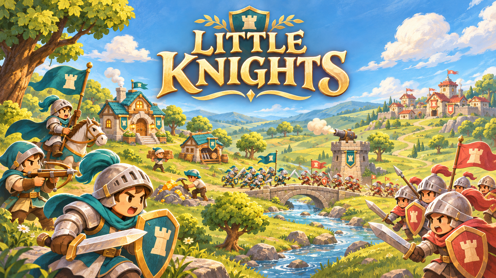

# Little Knights

A cute 2D real-time strategy game. Gather resources, build an army, expand your base and destroy the enemy Town Center.

[Play in your browser](https://eric-schecter.github.io/little-knights/)

## How to Play

- Click **Start Game**, then click **Easy / Normal / Hard** to begin immediately.
- **Left-click / drag:** Select units. **Shift:** Add to selection. Dragging a mixed area selects military units first; Shift-click can explicitly add a worker.
- **Right-click:** Move, attack, gather or repair a friendly building. Troop commands pass through friendly units. **Alt + right-click:** Target the ground beneath units or objects.
- Troops automatically defend after reaching a move or rally point.
- **X + left-click:** Attack-move. **H:** Stop, including automatic attacks. **Z:** Toggle workers' idle auto repair (on by default). Gathering, construction and movement take priority; H suspends repairs until a new order.
- **WASD / arrow keys / screen edges / middle-button drag:** Move the camera.
- **Minimap:** Click or drag to jump to a location.
- **Ctrl / Command + 1–9:** Save a group. Press its number to select; double-press to locate.
- Select a production building and right-click to set its rally point. Town Centers can rally workers onto resources.
- Open the top-right settings for pause, volume, fullscreen and restart.

## Run Locally

Open `project.godot` in **Godot 4.7.2**, then press **F6** in `main.tscn` or **F5**.

To export the Web build, install matching export templates and run `./tools/export_web.sh`. Serve `build/web` through HTTP; opening the HTML file directly is unsupported. Pushes to `main` build and deploy GitHub Pages automatically.

Art and cover were generated with AI. Music and sound effects use CC0 sources; see [asset credits](assets/SOURCES.md).
